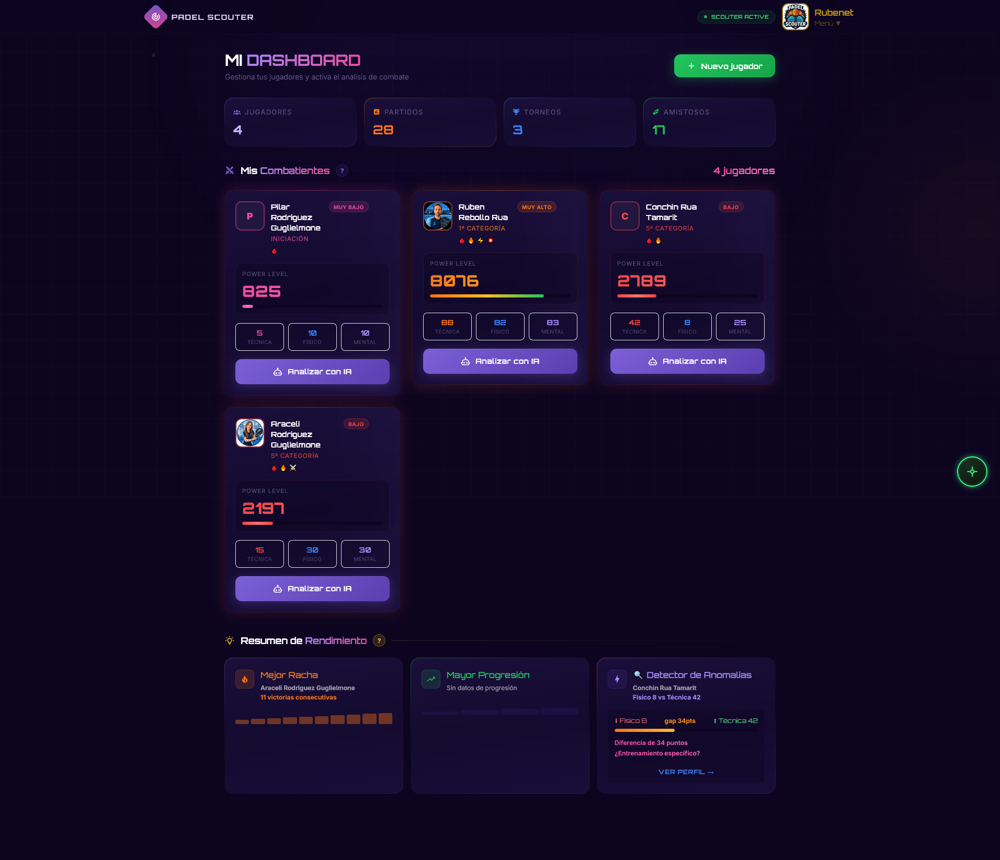
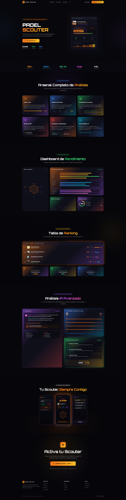
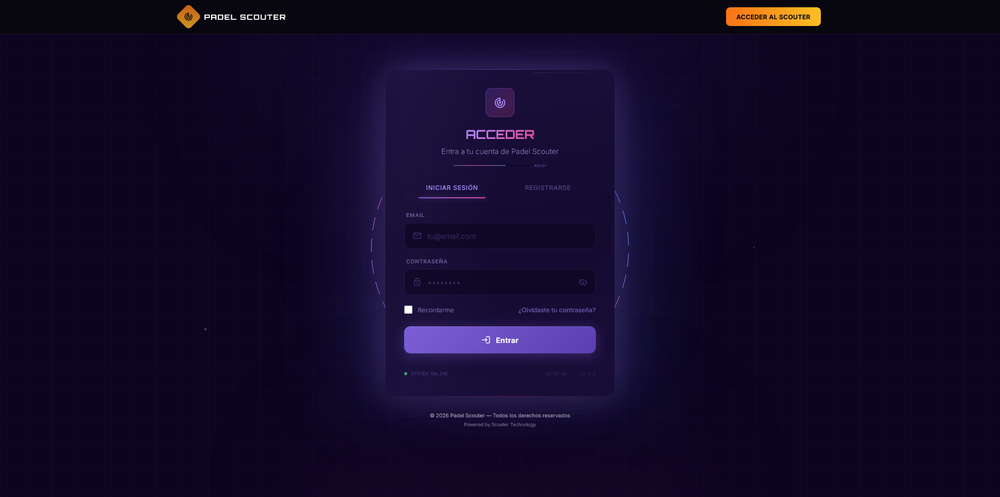
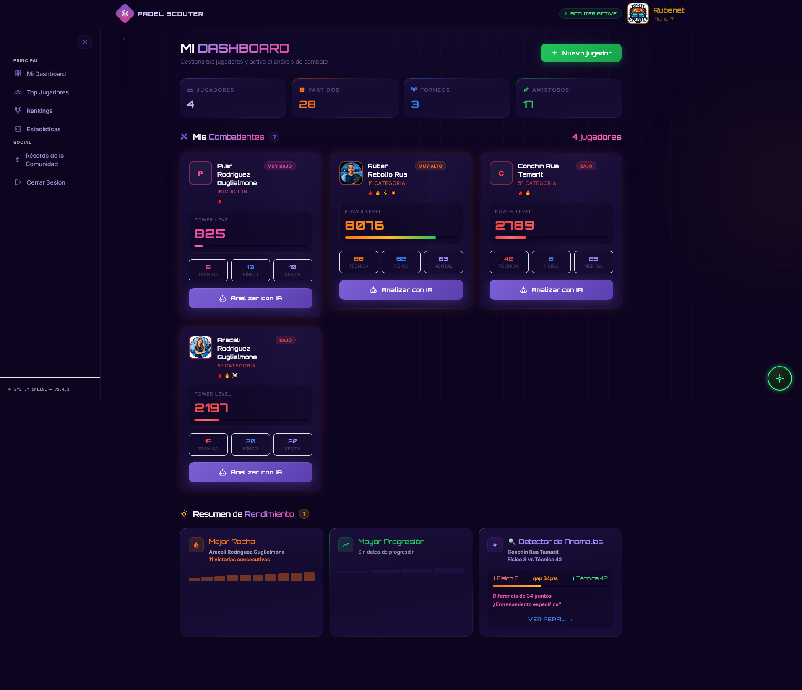
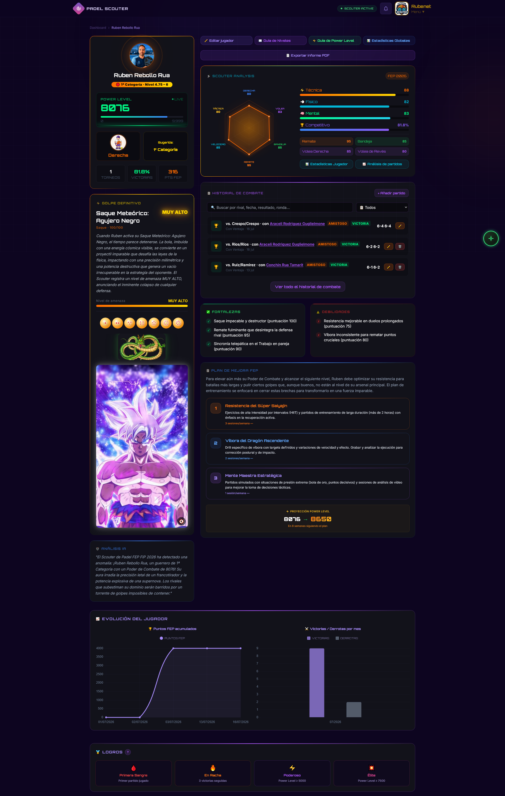
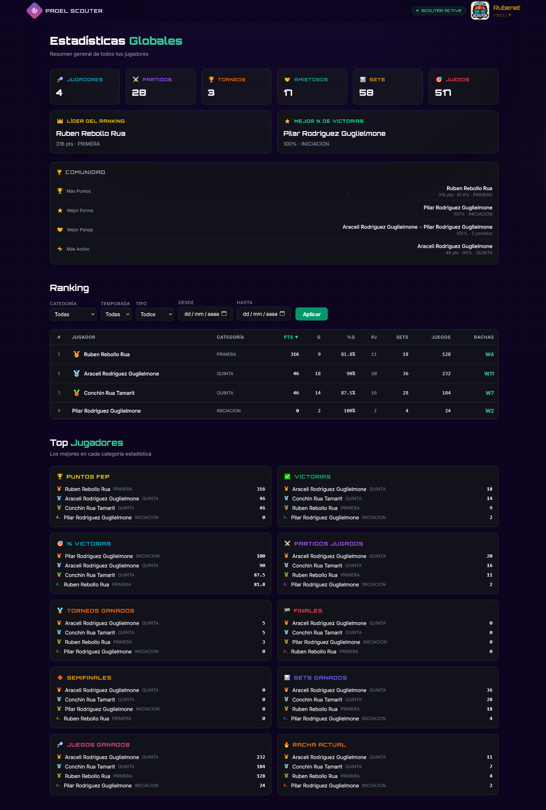
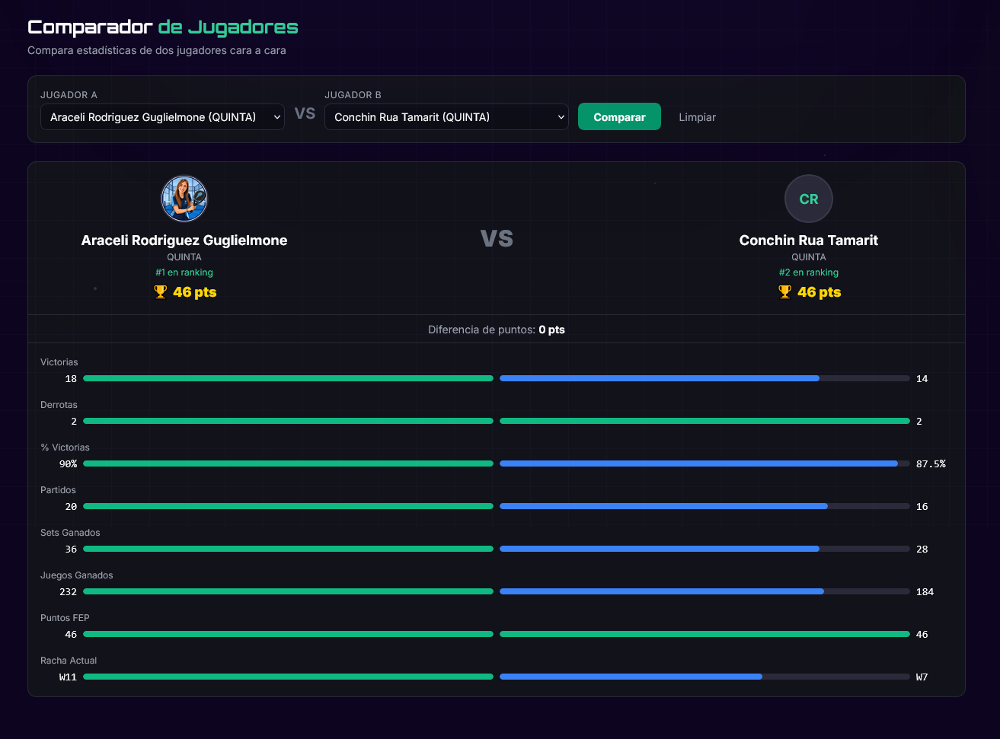
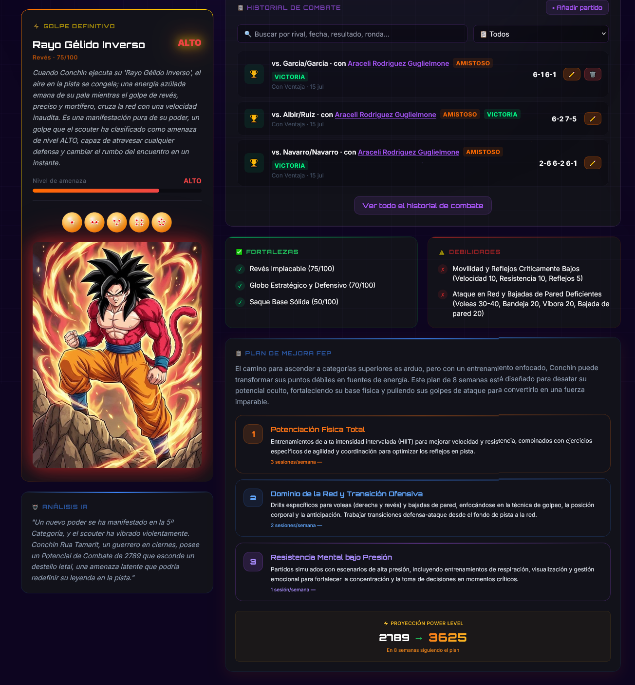
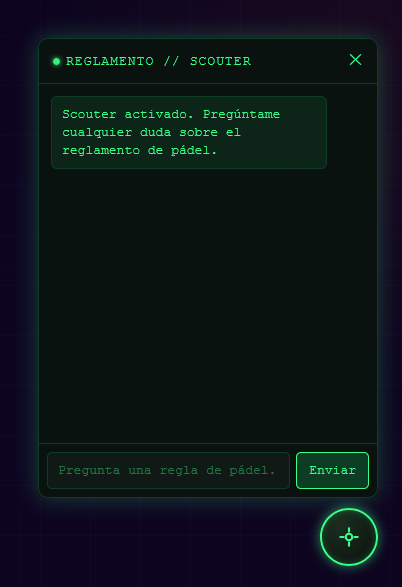
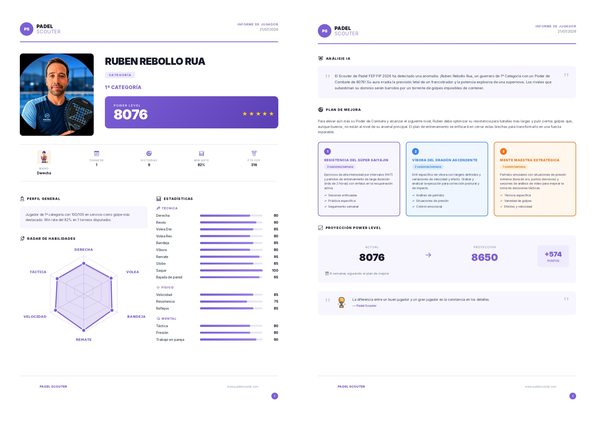

# 🎾 Padel Scouter

<p align="center">
  
</p>

**Sistema web inteligente para la gestión, análisis y seguimiento de jugadores y torneos de pádel.**

<p align="center">
  🎓 Trabajo Fin de Máster • FastAPI • Clean Architecture • PostgreSQL • IA con Gemini • RAG • Docker
</p>

> 📌 **Este repositorio es un escaparate (showcase) del proyecto.** Contiene la documentación, las capturas, el vídeo y una **muestra de código** (capa de dominio y tests unitarios). El código completo es privado; puedo facilitar acceso a procesos de selección bajo petición: [Ruben829@msn.com](mailto:Ruben829@msn.com).

**Estado del proyecto:** ✅ Finalizado (Trabajo Fin de Máster 2026)

**Arquitectura:** Clean Architecture (Hexagonal) · FastAPI · PostgreSQL · Redis · Google Gemini · WeasyPrint

[](https://www.python.org/)
[](https://fastapi.tiangolo.com/)
[](https://www.postgresql.org/)
[](https://redis.io/)
[](#-testing)
[](LICENSE.txt)

---

## 🔗 Recursos

- 📊 [Presentación del TFM (Slides)](docs/Padel_Scouter_Proyecto_TFM_Desarrollo_Con_IA.pptx)
- 🎥 [Vídeo demostración](https://youtu.be/uglVCCTKinU)
- 🌐 [Demo en producción](https://padel-scouter-production.up.railway.app) <!-- ACTUALIZAR esta URL al migrar de hosting -->
- 👤 **Usuario demo (rol jugador):** `demo_jugador@padel-scouter.com` / `DemoJugador2026!136f`
- ⚠️ Los emails de la demo se redirigen a una cuenta personal (sin dominio propio verificado para el envío)

---

## 📖 ¿Qué es Padel Scouter?

Los clubes de pádel, entrenadores y jugadores amateur carecen de herramientas profesionales para analizar el rendimiento, seguir la evolución de los jugadores y gestionar torneos de forma centralizada. Las soluciones existentes son hojas de cálculo improvisadas o software genérico que no entiende las particularidades del pádel: sistema FEP, categorías, rondas de torneo, parejas y reglas de competición.

Padel Scouter es una plataforma web completa que permite:

- **Gestionar** jugadores con perfiles detallados (19 estadísticas técnicas, físicas y mentales)
- **Registrar** partidos con validación inteligente de rondas de torneo y bloqueo de parejas
- **Analizar** el rendimiento con inteligencia artificial (Google Gemini), generando informes narrativos y planes de mejora personalizados
- **Clasificar** con un ranking basado en el sistema FEP, con estadísticas avanzadas, comparativas y evolución temporal
- **Exportar** informes profesionales en PDF con gráficos, análisis y proyecciones
- **Consultar** el reglamento oficial de pádel mediante un chatbot RAG (Retrieval-Augmented Generation)
- **Administrar** usuarios con un sistema de roles y permisos granulares

**Público objetivo:** entrenadores y directores técnicos de clubes, jugadores que quieren seguir su evolución, organizadores de torneos amateur y aficionados al pádel.

---

## ✨ Funcionalidades destacadas

### 👥 Jugadores y torneos

- Perfil completo con 19 campos de estadísticas (10 técnica, 3 físico, 3 mental, 3 competitivo), mano dominante y categorías FIP (Iniciación a Profesional)
- Avatar con validación, reencodeo seguro, eliminación de metadatos EXIF y renombrado aleatorio
- Borrado lógico con restauración
- Torneos con puntos FEP configurables, validación de duplicados y protección frente al borrado con partidos asociados

### ⚔️ Partidos con reglas de torneo

Validación de rondas con 4 reglas:

1. Una derrota bloquea partidos en rondas posteriores
2. Una derrota no puede coexistir con victorias en rondas superiores
3. No se pueden saltar rondas (deben ser consecutivas)
4. No se puede duplicar una ronda en el mismo torneo

Además: **bloqueo de parejas** (el compañero se fija para todo el torneo), **auto-swap** de roles y tres métodos de puntuación (Con Ventaja, Punto de Oro y Star Point).

### 🎖️ Sistema de logros

10 insignias que se calculan dinámicamente:

| Insignia | Requisito |
|---|---|
| 🩸 Primera Sangre | 1 partido jugado |
| 🔥 En Racha | 3 victorias consecutivas |
| ⚔️ Imparable | 10 victorias consecutivas |
| ⏳ Veterano | 50 partidos totales |
| 💯 Centenario | 100 partidos totales |
| 🛡️ Invicto | 100% victorias (mín. 3) |
| 🏆 Campeón | 1 torneo ganado |
| 🤖 Máquina | 10 torneos ganados |
| ⚡ Poderoso | Power Level ≥ 5000 |
| 💥 Élite | Power Level ≥ 7500 |

### 📊 Estadísticas avanzadas

- **Ranking FEP**: puntos ponderados por la mejor ronda alcanzada en cada torneo
- **Power Level**: puntuación compuesta (0–9999) que integra técnica (45%), físico (25%), mental (20%) y rendimiento competitivo (10%), con clasificación automática por categoría
- Evolución temporal, comparador, historial H2H, Top 10 por 10 métricas, récords y resumen global
- Filtros por categoría, temporada, tipo de competición y rango de fechas
- **Alcance personal**: todas las estadísticas se calculan solo sobre los jugadores del propio usuario, para todos los roles

### 🤖 Inteligencia Artificial

- **Análisis de jugador** con Gemini 2.5 Flash: descripción, fortalezas, debilidades y plan de mejora en 3 fases
- **Golpe definitivo** y **proyección de Power Level** a 8 semanas
- **Chatbot de reglamento** con RAG sobre el PDF oficial de reglas de pádel; solo responde con información del reglamento
- Caché en Redis y degradación controlada si la API o la caché no están disponibles

### 📄 Informes PDF

Informe profesional generado con WeasyPrint (HTML + CSS → PDF): portada con Power Level y gráfico radar, análisis de IA, plan de mejora y proyección. Descarga con tokens JWT de 5 minutos, sin exponer el token de sesión.

### 🔔 Notificaciones e interfaz

- Notificaciones automáticas al añadir un compañero a un partido
- Tema oscuro inspirado en el Scouter de Dragon Ball Z, diseño responsive, modales interactivos y chatbot flotante

---

## 🛡️ Roles, permisos y ownership

RBAC (control de acceso basado en roles) con permisos granulares, una única fuente de verdad (`app/domain/authorization/policy.py`) y enfoque **fail-closed**: ante un rol desconocido, sin permisos.

| Rol | Alcance | Límite de jugadores | Permisos destacados |
|---|---|---|---|
| `admin` | `GLOBAL` | ilimitado | Todos los permisos del sistema |
| `entrenador` | `ROSTER` | 25 | Los de `jugador` + restaurar jugadores, comparar, generar y descargar informes |
| `jugador` | `OWN` | 2 | CRUD de jugadores y partidos propios, estadísticas, IA, torneos y notificaciones |

- **27 permisos** con nomenclatura `recurso.accion` (por ejemplo `players.update`, `users.suspend`)
- **Ownership** por `owner_id`, asignado en el servidor desde el usuario autenticado
- **Lectura frente a escritura**: las operaciones sobre recursos de otro propietario responden `404`, también para el administrador
- Las restricciones se aplican **en el backend**, no ocultando datos en el cliente

## 🧑‍💼 Panel de administración

Área exclusiva del rol `admin` para la administración global de usuarios:

- Listado paginado con búsqueda y filtros por rol y estado, y tarjetas de resumen
- Cambio de rol `jugador` ↔ `entrenador`
- Suspensión y reactivación de cuentas con confirmación; no se puede suspender la propia cuenta ni dejar el sistema sin administradores activos
- Auditoría de las acciones en la tabla `audit_log`

---

## 🔐 Seguridad

Protecciones alineadas con el **OWASP Top 10**:

- Autenticación JWT (access de 30 min + refresh de 7 días) y contraseñas con bcrypt
- Validación de contraseñas, tokens de recuperación de corta duración y mensajes genéricos anti-enumeración
- Rate limiting por IP y consultas parametrizadas con validación mediante Pydantic
- Cuentas suspendidas bloqueadas en cada petición, sin depender del token ya emitido
- Registro con rol fijo: nadie puede autoasignarse privilegios

---

## 🔧 Stack tecnológico

| Capa | Tecnología |
|---|---|
| **Lenguaje** | Python 3.14+ |
| **Framework** | FastAPI 0.138 · Uvicorn |
| **ORM y migraciones** | SQLAlchemy 2.0 · Alembic |
| **Base de datos** | PostgreSQL 16 |
| **Caché** | Redis 7 |
| **Autenticación** | python-jose (JWT) · bcrypt |
| **Validación** | Pydantic v2 |
| **IA** | Google Gemini (SDK genai) |
| **PDF** | WeasyPrint |
| **Imágenes** | Pillow |
| **Email** | Resend |
| **Rate limiting** | slowapi |
| **Plantillas** | Jinja2 |
| **Testing** | pytest · pytest-asyncio · pytest-cov |
| **Calidad** | ruff · black |
| **Contenedores** | Docker · Docker Compose |

---

## 🏗️ Arquitectura

**Clean Architecture (Hexagonal)** con separación estricta de responsabilidades:

```
┌─────────────────────────────────────────────┐
│                  API Layer                   │
│         (FastAPI routers — HTTP)             │
└──────────────────┬──────────────────────────┘
                   │
┌──────────────────▼──────────────────────────┐
│              Service Layer                   │
│     (orquestación — lógica de aplicación)    │
└──────┬───────────────────────┬──────────────┘
       │                       │
┌──────▼──────────┐   ┌───────▼──────────────┐
│  Domain Layer   │   │  Infrastructure      │
│  (lógica pura)  │   │  (repositorios,      │
│  power_level,   │   │   AI, PDF, email,    │
│  fep, rounds,   │   │   cache, DB)         │
│  metrics, score │   │                      │
└─────────────────┘   └──────────────────────┘
```

- **Domain Layer**: sin dependencias de infraestructura (cero imports de SQLAlchemy); lógica de negocio pura y testeable sin base de datos
- **Service Layer**: orquesta el flujo entre API, repositorios y dominio
- **Repository Layer**: todo el acceso a datos vive aquí
- **Inversión de dependencias** y **responsabilidad única** por módulo

---

## 📁 Qué contiene este repositorio

Este escaparate incluye una **muestra de código** del proyecto completo:

- `app/domain/` — capa de dominio (value objects, reglas de negocio y política RBAC)
- `tests/unit/` — tests unitarios de esa muestra
- `images/` — capturas de la aplicación
- `docs/` — presentación del TFM

El proyecto completo (API, servicios, infraestructura, plantillas, migraciones y tests de integración) se mantiene en un repositorio privado.

---

## 🧪 Testing

El proyecto completo suma **406 tests automatizados**: 118 unitarios y 288 de integración.

Áreas cubiertas: Power Level y reglas de puntuación, validación de contraseñas y seguridad, análisis de IA, política RBAC y permisos, ownership y scopes, estadísticas por propietario, panel de administración y suspensión de cuentas, PDFs, chatbot y notificaciones.

En este repositorio se incluyen los tests unitarios de la muestra de código.

---

## 📸 Capturas

### Landing Page


### Login


### Dashboard


### Menú


### Perfil del Jugador


### Ranking Global


### Comparador de Jugadores


### Análisis IA


### Chatbot de Reglamento


### Informe PDF


---

## 🎯 Qué demuestra este proyecto

- **Arquitectura limpia**: capas desacopladas, dominio puro y reglas de negocio testeadas sin base de datos
- **Autorización seria**: RBAC fail-closed, permisos granulares y ownership aplicado en el backend, con tests de seguridad
- **IA aplicada**: análisis con Gemini, RAG sobre documentación oficial, caché y degradación controlada
- **Seguridad**: buenas prácticas OWASP, autenticación JWT, rate limiting y auditoría de acciones de administración
- **Calidad**: 406 tests automatizados y migraciones versionadas
- **Producto completo**: backend, interfaz, generación de PDF, despliegue en la nube con PostgreSQL y Redis gestionados

---

## 🔮 Próximos pasos

- [ ] Internacionalización (inglés, francés, italiano)
- [ ] Notificaciones en tiempo real con WebSockets
- [ ] Importación masiva de jugadores y partidos (CSV/Excel)
- [ ] Catálogo global de jugadores y estadísticas globales del sistema para administración
- [ ] Asignación explícita entrenador ↔ jugador
- [ ] Tests E2E y CI/CD con GitHub Actions
- [ ] PWA o aplicación móvil

---

## 📄 Licencia

Código publicado solo para evaluación y portfolio. © 2026 Rubén Rebollo Rua. Todos los derechos reservados. Ver [LICENSE.txt](LICENSE.txt).

---

## 👨‍💻 Autor

**Rubén Rebollo Rua**

- 📧 [Ruben829@msn.com](mailto:Ruben829@msn.com)
- 💻 [github.com/rubenet84](https://github.com/rubenet84)
- 🎓 Máster en Desarrollo con IA
- 📅 2026
<!-- Añade aquí tu LinkedIn si quieres -->

---

<p align="center">
  <sub>Built with ❤️ using Python, FastAPI, and Clean Architecture</sub>
</p>
